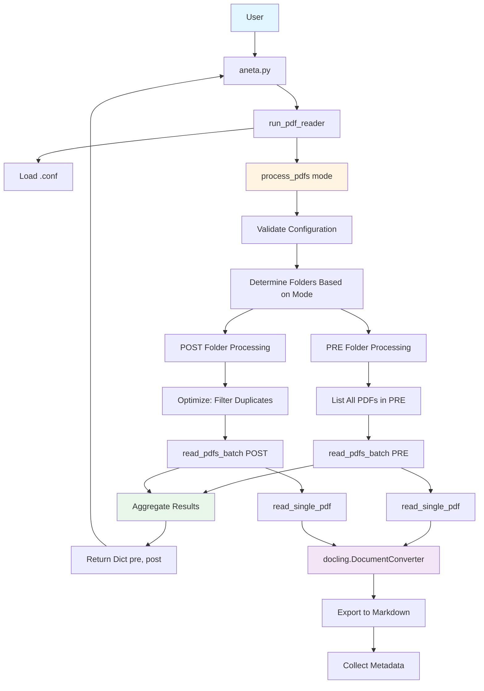
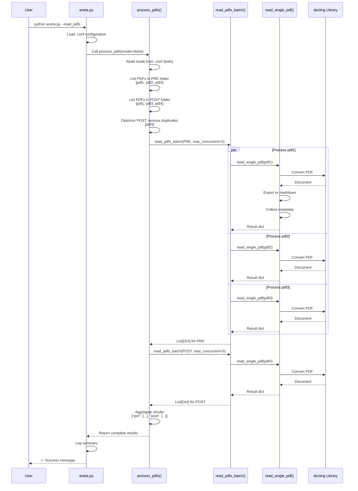
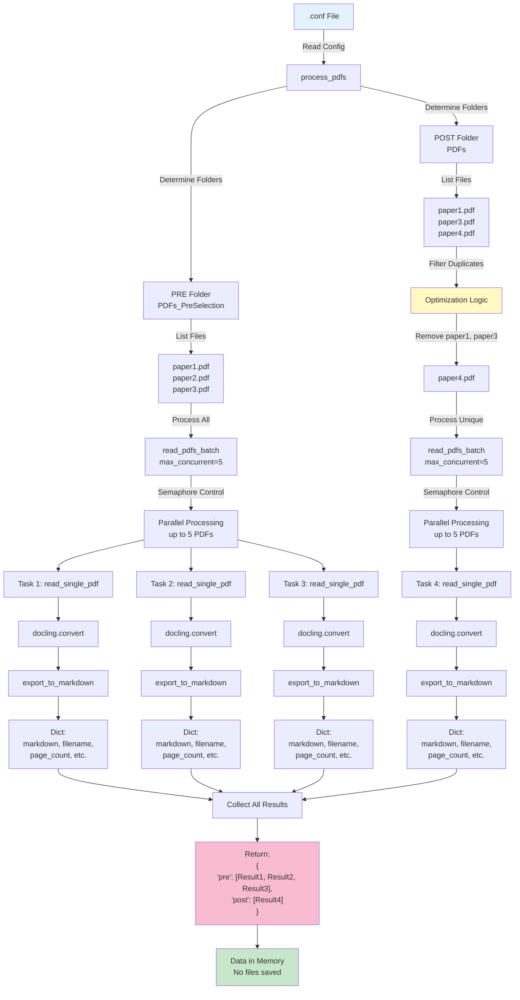
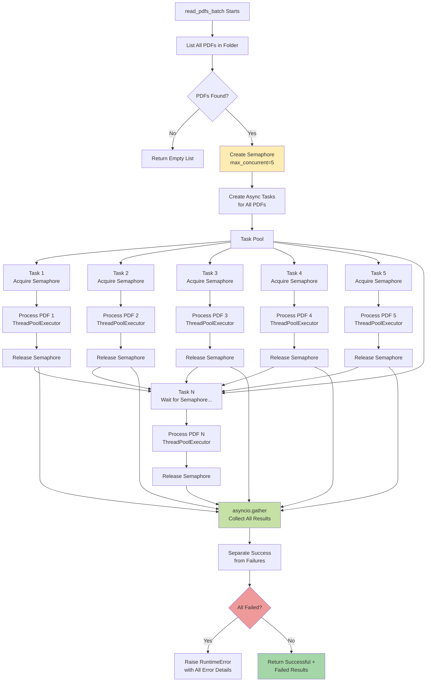
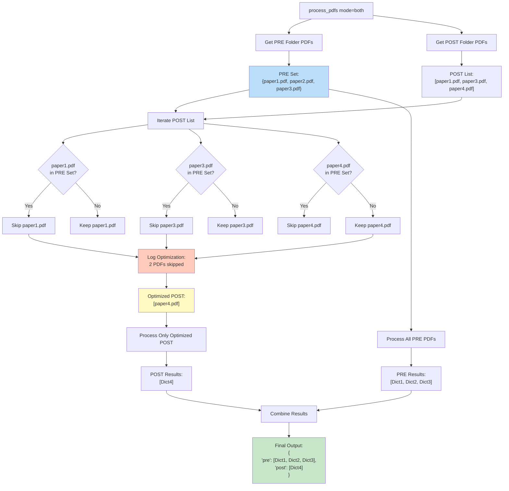

# REQUIREMENTS AND DEVELOPMENT REQUEST DOCUMENT (DRSD)

# PDFReader.py Refactoring - Docling-based PDF Processing System

**Project**: ASRL (Automated Systematic Review Library)  
**Feature**: PDF Processing with Async Batch Support  
**Creation Date**: 19 de outubro de 2025  
**Document Version**: 1.1  
**Status**: ✅ Approved

---

## 1. CONTEXT AND OBJECTIVE

### 1.1 Business Context

O projeto ASRL realiza revisões sistemáticas de literatura científica. Durante o processo, PDFs de artigos precisam ser convertidos para formato markdown para posterior análise por LLMs. O módulo atual (`src/PDFReader.py`) possui funcionalidade básica mas carece de:

- Processamento eficiente em lote
- Retorno de dados em memória
- Otimização para evitar reprocessamento
- Configurações flexíveis de concorrência

### 1.2 Current Pain Points

1. **NameError em `aneta.py`**: Funções necessárias não estão sendo exportadas corretamente
2. **Falta de Async Processing**: Processamento síncrono é lento para múltiplos PDFs
3. **Processamento Redundante**: PDFs em `post` já foram processados em `pre`, causando desperdício
4. **Falta de Retorno em Memória**: Sistema só salva arquivos, sem retornar dados para uso imediato
5. **Configuração Rígida**: Sem controle de concorrência para ambientes com recursos limitados

### 1.3 Objective

Refatorar `src/PDFReader.py` para fornecer uma API robusta, assíncrona e configurável que:

- Processe PDFs com paralelismo controlado
- Retorne dados estruturados em memória
- Otimize processamento evitando redundâncias
- Integre-se perfeitamente com `aneta.py`

---

## 2. CORE FUNCTIONALITY

### 2.1 Function Signatures

#### Function 1: `read_single_pdf(pdf_path: str) -> Dict[str, Any]`

Função base para processar um único PDF usando docling.

**Input**: Caminho para arquivo PDF  

**Output**: 

```python
{
    "markdown": str,           # Conteúdo em markdown
    "filename": str,           # Nome do arquivo
    "page_count": int,         # Número de páginas
    "processing_time": float,  # Tempo de processamento (segundos)
    "file_size_mb": float,     # Tamanho do arquivo
    "success": bool,           # Status de sucesso
    "error": Optional[str]     # Mensagem de erro (se houver)
}
```

#### Function 2: `read_pdfs_batch(folder_path: str, max_concurrent: int = 5) -> List[Dict[str, Any]]`

Processamento assíncrono em lote com controle de concorrência.

**Behavior**:

- Processa até `max_concurrent` PDFs em paralelo
- Continua processando mesmo se alguns PDFs falharem
- Lança exceção apenas se TODOS os PDFs falharem
- Retorna lista de dicionários (mesmo formato de `read_single_pdf`)

#### Function 3: `process_pdfs(mode: Optional[str] = None) -> Dict[str, List[Dict[str, Any]]]`

Orquestrador principal que integra com configuração.

**Output**:

```python
{
    "pre": [
        {
            "markdown": "...",
            "filename": "paper1.pdf",
            "page_count": 12,
            "processing_time": 3.45,
            "file_size_mb": 2.3,
            "success": True,
            "error": None
        }
    ],
    "post": [
        # Apenas PDFs que NÃO estão em 'pre'
    ]
}
```

**Optimization Logic**:

- Identifica PDFs em `PDF_PRE_SELECTION_FOLDER`
- Para modo `post` ou `both`: filtra PDFs já existentes em `pre`
- Processa apenas PDFs únicos em cada categoria

---

## 3. ARCHITECTURE DIAGRAMS (Mermaid)

### 3.1 High-Level Architecture



### 3.2 Sequence Diagram - Main Flow



### 3.3 Data Flow Diagram



### 3.4 Async Concurrency Control Flow



### 3.5 PDF Deduplication Algorithm



### 3.6 Error Handling Flow

```mermaid
flowchart TD
    Start[read_single_pdf] --> ValidateFile{PDF File<br/>Exists?}
    
    ValidateFile -->|No| ReturnError1["Return:<br/>{success: False,<br/>error: 'File not found'}"]
    ValidateFile -->|Yes| StartTimer[Start Processing Timer]
    
    StartTimer --> InitConverter[Initialize<br/>DocumentConverter]
    InitConverter --> TryConvert{Try Convert<br/>with Timeout}
    
    TryConvert -->|Timeout| ReturnError2["Return:<br/>{success: False,<br/>error: 'Timeout after 60s'}"]
    TryConvert -->|Corrupted PDF| ReturnError3["Return:<br/>{success: False,<br/>error: 'Conversion failed'}"]
    TryConvert -->|Success| ExportMD[Export to Markdown]
    
    ExportMD --> CollectMetadata[Collect Metadata:<br/>- page_count<br/>- file_size<br/>- processing_time]
    
    CollectMetadata --> ReturnSuccess["Return:<br/>{success: True,<br/>markdown: '...',<br/>...metadata}"]
    
    ReturnError1 --> LogError[Log Error]
    ReturnError2 --> LogError
    ReturnError3 --> LogError
    ReturnSuccess --> LogSuccess[Log Success]
    
    LogError --> BatchCollect[Batch Collector]
    LogSuccess --> BatchCollect
    
    BatchCollect --> CheckAllFailed{All PDFs<br/>Failed?}
    
    CheckAllFailed -->|Yes| RaiseException[Raise RuntimeError:<br/>'All X PDFs failed: [errors]']
    CheckAllFailed -->|No| ReturnPartial["Return Partial Results:<br/>Successful + Failed PDFs"]
    
    style ReturnError1 fill:#ffcdd2
    style ReturnError2 fill:#ffcdd2
    style ReturnError3 fill:#ffcdd2
    style ReturnSuccess fill:#c8e6c9
    style RaiseException fill:#ef5350
    style ReturnPartial fill:#fff9c4
```

---

## 4. FUNCTIONAL REQUIREMENTS

| ID | Requirement | Priority | Acceptance Criteria |
|----|-------------|----------|---------------------|
| FR-01 | Processar PDF único retornando markdown e metadados | HIGH | Função retorna dicionário com 7 campos especificados |
| FR-02 | Processar múltiplos PDFs assincronamente | HIGH | Processa N PDFs em paralelo (N configurável) |
| FR-03 | Ler configurações de `.conf` | HIGH | Lê 5 variáveis de ambiente corretamente |
| FR-04 | Evitar reprocessamento de PDFs | MEDIUM | PDFs em `post` que existem em `pre` são ignorados |
| FR-05 | Retornar dados em memória (não salvar arquivos) | HIGH | Nenhum arquivo markdown é criado |
| FR-06 | Suportar 3 modos de processamento | HIGH | `pre`, `post`, `both` funcionam corretamente |
| FR-07 | Continuar processamento em caso de falha parcial | HIGH | Se 1 de 10 PDFs falhar, 9 são retornados |
| FR-08 | Lançar exceção se todos falharem | MEDIUM | Exception com detalhes de todos os erros |
| FR-09 | Integrar com `aneta.py` | HIGH | `run_pdf_reader()` usa `process_pdfs()` |
| FR-10 | Configurar limite de concorrência | MEDIUM | Variável `PDF_MAX_CONCURRENT` em `.conf` |

---

## 5. NON-FUNCTIONAL REQUIREMENTS

| ID | Requirement | Priority | Metric |
|----|-------------|----------|--------|
| NFR-01 | Performance | HIGH | Processar 100 PDFs em < 5 minutos (avg 3s/PDF) |
| NFR-02 | Memory Efficiency | HIGH | Uso de memória < 2GB para 100 PDFs |
| NFR-03 | Error Resilience | HIGH | Sistema continua operando com 20% de falhas |
| NFR-04 | Logging | MEDIUM | Logs estruturados para debug |
| NFR-05 | Timeout per PDF | MEDIUM | 60s por PDF (configurável) |
| NFR-06 | Type Safety | HIGH | Type hints completos em todas as funções |
| NFR-07 | Backward Compatibility | LOW | Manter `read_pdfs_with_docling()` funcional |
| NFR-08 | Configuration Validation | MEDIUM | Validar caminhos e valores de .conf |

---

## 6. CONFIGURATION

### 6.1 New Variables for `.conf`

```bash
# Existing (already in .conf)
PATH_DATA=".data"
PDF_PRE_SELECTION_FOLDER="PDFs_PreSelection"
PDF_POST_SELECTION_FOLDER="PDFs"

# NEW - to be added
PDF_MAX_CONCURRENT=5           # Default: 5 PDFs in parallel
PDF_TIMEOUT_SECONDS=60         # Default: 60s per PDF
PDF_PROCESSING_MODE="both"     # Default: "both" | Options: "pre", "post", "both"
```

---

## 7. IMPLEMENTATION TIMELINE

| Phase | Tasks | Time | Priority |
|-------|-------|------|----------|
| **Phase 1** | Implement `read_single_pdf()` + tests | 4h | HIGH |
| **Phase 2** | Implement `read_pdfs_batch()` async + tests | 5h | HIGH |
| **Phase 3** | Implement `process_pdfs()` + optimization | 3h | HIGH |
| **Phase 4** | Update `aneta.py` + integration tests | 3h | HIGH |
| **Phase 5** | Code review + documentation | 4h | MEDIUM |
| **TOTAL** | | **19h** | |

**Estimated Duration**: 5 working days (4h/day)

---

## 8. RISKS AND MITIGATIONS

| Risk | Probability | Impact | Mitigation |
|------|------------|--------|------------|
| docling breaking changes | LOW | HIGH | Pin version in pyproject.toml |
| Memory exhaustion | MEDIUM | HIGH | Enforce max_concurrent limit |
| Slow processing | MEDIUM | MEDIUM | Set timeout (60s) |
| Config errors | MEDIUM | LOW | Validate all config values |

---

## 9. ACCEPTANCE CRITERIA

### 9.1 Success Criteria

- ✅ All 10 functional requirements met
- ✅ All 8 non-functional requirements met
- ✅ Unit test coverage > 80%
- ✅ Integration tests pass
- ✅ Performance benchmarks met
- ✅ Documentation complete

### 9.2 Test Scenarios

1. Process single PDF successfully
2. Process batch with all successes
3. Process batch with partial failures
4. Process batch with all failures (raises exception)
5. Mode `pre` only
6. Mode `post` only
7. Mode `both` with optimization
8. Invalid configuration handling
9. Timeout handling
10. Memory efficiency under load

---

## DOCUMENT APPROVAL

**Prepared by**: GitHub Copilot (Senior Software Architect)  
**Date**: 19 de outubro de 2025  
**Version**: 1.1  
**Status**: ✅ Approved

**Next Steps**:

1. ✅ DRSD Approved
2. ✅ Development Request Generated
3. ✅ Task List Generated
4. ⏭️ Begin Implementation