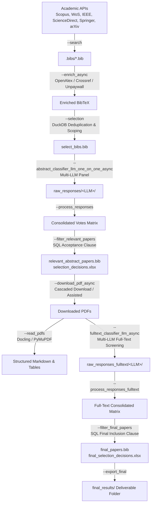

# Aneta: Automated Systematic Literature Review & Mapping Pipeline

[](https://www.python.org/downloads/)
[](LICENSE)
[](#agentic-facilitator-human-in-the-loop)

**Aneta** (ASRL - *Automated Systematic Review Library*) is a robust, modular, and production-grade pipeline designed to automate and accelerate Systematic Literature Reviews (SLR) and Systematic Mapping Studies (SMS).

Combining deterministic academic search engines, asynchronous metadata enrichment, multi-LLM consensus voting, resilient PDF acquisition, and comprehensive bibliometric analytics, Aneta guarantees methodological rigor, auditability, and reproducibility under a **Human-in-the-Loop** model.

---

## Key Highlights

- **Multi-Database Academic Search**: Unified boolean DSL automatically translated into native query syntaxes for **Scopus**, **Web of Science**, **IEEE Xplore**, **ScienceDirect**, **Springer Nature**, and **arXiv**.
- **Asynchronous Enrichment & Deduplication**: High-speed metadata completion via **OpenAlex**, **Crossref**, **Unpaywall**, **DataCite**, and **Semantic Scholar**, backed by **LanceDB** caching and **DuckDB** SQL deduplication and scoping.
- **Multi-LLM Consensus Screening**: Automated abstract and full-text screening using a panel of diverse LLMs (OpenAI, Google Gemini, DeepSeek). Inclusion decisions are governed by transparent, declarative SQL voting clauses with full per-paper decision auditing.
- **Resilient PDF Acquisition Cascade**: Multi-tiered download cascade leveraging publisher APIs, Unpaywall open-access links, and an assisted human-in-the-loop browser mode for Cloudflare-protected venues.
- **High-Throughput PDF Parsing**: Fast, structured extraction of text, tables, and figures from PDFs via **Docling** and **PyMuPDF** with configurable concurrency.
- **Dual-Stage Bibliometrics**: Integrated bibliometric analysis (R Bibliometrix & Python visual analytics) parameterizable to run after abstract screening or at the final inclusion stage.
- **PRISMA-Compliant Reporting**: Automatically generates PRISMA-style funnel metrics, markdown review reports, decision spreadsheets, and delivery packages.
- **Human-in-the-Loop AI Facilitator**: Run via CLI or guided by specialized AI agents across IDEs (**Antigravity**, **Claude Code**, **Codex**, **OpenCode**) ensuring researchers stay in complete control of methodology.

---

## End-to-End Pipeline Architecture

```
   Phase 0: Setup & Protocol
   (research_questions.yaml + search_config.yaml + .conf + config/.env)
                │
                ▼
   Phase 1: Search, Async Enrichment & Selection
   (--search ──► --enrich_async ──► --selection)
                │
                ▼
   Phase 2: Abstract Multi-LLM Screening
   (--abstract_classifier_llm_one_on_one_async ──► --process_responses ──► --filter_relevant_papers)
                │
                ├──► Phase 2.5: Optional Bibliometrics (Post-Abstract)
                │    (--bibliometry_async --stage post_abstract)
                ▼
   Phase 3: PDF Acquisition & Parsing
   (--download_pdf_async / --download_pdf_assisted ──► --read_pdfs)
                │
                ▼
   Phase 4: Full-Text Multi-LLM Screening
   (--fulltext_classifier_llm_async ──► --process_responses_fulltext ──► --filter_final_papers)
                │
                ├──► Phase 5: Final Bibliometrics
                │    (--bibliometry_async --stage final)
                ▼
   Phase 6: Reporting & Deliverables Packaging
   (--pipeline_report ──► --export_final)
```

### Flowchart



---

## Installation & Prerequisites

### 1. Requirements
- **Python**: `>= 3.12.7`
- **Pandoc**: Required for report compilation (`brew install pandoc` on macOS, `sudo apt-get install pandoc` on Ubuntu/Debian).
- **R (Optional, for advanced bibliometrics)**: Install `R` and bibliometric packages if running R Bibliometrix.
- **Playwright / Chromium (Optional, for assisted PDF downloads)**: Needed for the assisted browser mode.

### 2. Environment Setup

#### Option A: Using `uv` (Recommended - Fastest)
```bash
# Clone the repository
git clone git@github.com:leandroimail/aneta.git
cd aneta

# Sync dependencies
uv sync

# Run any command using uv
uv run python aneta.py --help
```

#### Option B: Automated Bootstrap Script (`aneta-runner`)
The repository includes a self-healing bootstrap script that resolves a functional Python environment and installs required core dependencies:
```bash
PY="$(bash .agents/skills/aneta-runner/scripts/ensure_env.sh "$PWD")"
PYTHONUNBUFFERED=1 "$PY" aneta.py --help
```

#### Option C: Standard Virtual Environment (`pip`)
```bash
python3 -m venv .venv
source .venv/bin/activate
pip install -r requirements.txt
python aneta.py --help
```

#### Optional Dependencies On-Demand
- **Docling (PDF structured parsing)**:
  ```bash
  pip install docling
  ```
- **Playwright (Assisted browser download)**:
  ```bash
  pip install playwright undetected_chromedriver "setuptools<81"
  playwright install chromium
  ```

---

## Configuration Architecture

Aneta adheres to a clean separation between **Operational Settings**, **Research Methodology**, and **Credentials**:

| Configuration File | Versioned? | Role & Purpose |
|--------------------|------------|----------------|
| `.conf` | **Yes** | **Operational parameters**: paths, directories, concurrency limits, timeouts, and character limits. |
| `config/*.yaml` | **Yes** | **Research Methodology**: research questions, search queries, database selectors, and SQL voting clauses. |
| `config/.env` | **No** (gitignored) | **Secrets & LLM Clients**: API keys (Elsevier, WoS, IEEE, Springer) and multi-LLM screening panels (`LLM_CLIENTS_*`). |

> [!CAUTION]
> **API Keys and Credentials Security**: Never commit or print API keys. All keys must reside exclusively inside `config/.env`, which is strictly ignored by Git.

### 1. Environment & API Keys (`config/.env`)
Create `config/.env` from the provided template or specify your credentials:
```bash
# Academic Search & Publisher APIs
ELSEVIER_API_KEY="your-key"
ELSEVIER_INSTTOKEN="your-institution-token"
WEB_OF_SCIENCE_KEY="your-key"
IEEE_API_KEY="your-key"
SPRINGER_API_KEY="your-key"

# LLM Providers for Screening
OPENAI_API_KEY="sk-..."
GEMINI_API_KEY="AIza..."
DEEPSEEK_API_KEY="sk-..."

# Abstract Multi-LLM Panel Configuration
LLM_CLIENTS_ABSTRACT='[
  {"provider": "openai", "model": "gpt-4o-mini", "api_key_env": "OPENAI_API_KEY", "rate_limit_per_minute": 60},
  {"provider": "gemini", "model": "gemini-2.0-flash", "api_key_env": "GEMINI_API_KEY", "rate_limit_per_minute": 60},
  {"provider": "deepseek", "model": "deepseek-chat", "api_key_env": "DEEPSEEK_API_KEY", "rate_limit_per_minute": 60}
]'

# Full-Text Multi-LLM Panel Configuration
LLM_CLIENTS_FULL_TEXT='[
  {"provider": "openai", "model": "gpt-4o", "api_key_env": "OPENAI_API_KEY", "rate_limit_per_minute": 30},
  {"provider": "gemini", "model": "gemini-2.0-flash", "api_key_env": "GEMINI_API_KEY", "rate_limit_per_minute": 60}
]'
```

### 2. Operational Parameters (`.conf`)
Key runtime options in `.conf`:
```ini
PATH_DATA=".data"
BIB_FILE="OUTPUTS/select_bibs.bib"
FOLDER_SAVE_PDF="PDFs"
DOWNLOAD_MAX_CONCURRENT=8
PDF_MAX_CONCURRENT=5
PDF_TIMEOUT_SECONDS=60
FULLTEXT_MAX_CHARS=400000
FINAL_RESULTS_FOLDER="OUTPUTS/final_results"
```

### 3. Protocol & Methodology (`config/*.yaml`)
- `config/research_questions.yaml`: Author the principal research question, supporting questions (`sq1`...), and acceptance/rejection criteria (`ac1`..., `rc1`...).
- `config/search_config.yaml`: Define database targets (`scopus: true`, `ieee: true`, etc.) and the search query in Aneta's boolean DSL.
- `config/filter_accept_results_llm.yaml`: Define the SQL acceptance clause for abstract screening (e.g. `(ac1_yes >= 2) AND (rc1_no <= 1)`).
- `config/filter_accept_results_llm_fulltext.yaml`: Define the final SQL acceptance clause for full-text screening.

---

## Command-Line Usage (Step-by-Step)

Each step is independent and **DOI-aware**: if interrupted, re-running skips already completed items, making long executions fully resilient.

### Phase 1: Search, Metadata Enrichment & Scope Filtering
```bash
# 1. Execute database search via APIs
python aneta.py --search

# 2. Asynchronously enrich citations, abstracts, DOIs, JCR, and SCImago
python aneta.py --enrich_async

# 3. Deduplicate and apply scope filters using DuckDB SQL
python aneta.py --selection
```

### Phase 2: Multi-LLM Abstract Screening
```bash
# 1. Run multi-LLM classification on abstracts
python aneta.py --abstract_classifier_llm_one_on_one_async

# 2. Consolidate LLM votes into decision matrix
python aneta.py --process_responses

# 3. Apply SQL acceptance clause and generate decision justification spreadsheet
python aneta.py --filter_relevant_papers

# Shortcut for steps 2 and 3:
# python aneta.py --select_abstracts
```

### Phase 2.5: Post-Abstract Bibliometrics (Optional)
```bash
# Run bibliometric analysis on the abstract-accepted corpus
python aneta.py --bibliometry_async --stage post_abstract
```

### Phase 3: PDF Acquisition & Parsing
```bash
# 1. Download PDFs concurrently
python aneta.py --download_pdf_async

# 2. (If needed) Acquire remaining Cloudflare-blocked PDFs with assisted visible browser
python aneta.py --download_pdf_assisted

# 3. (Optional) Parse PDFs into structured Markdown, tables, and images with Docling
python aneta.py --read_pdfs
```

### Phase 4: Full-Text Multi-LLM Screening
```bash
# 1. Run multi-LLM screening on full paper texts
python aneta.py --fulltext_classifier_llm_async

# 2. Consolidate full-text votes
python aneta.py --process_responses_fulltext

# 3. Apply final SQL acceptance filter
python aneta.py --filter_final_papers

# Shortcut for steps 2 and 3:
# python aneta.py --select_fulltext
```

### Phase 5 & 6: Final Bibliometrics, Reporting & Delivery
```bash
# 1. Final bibliometrics on fully included papers
python aneta.py --bibliometry_async --stage final

# 2. Generate PRISMA pipeline report, funnel CSV, and metrics JSON
python aneta.py --pipeline_report

# 3. Export delivery package (selected PDFs, final BibTeX, summary reports)
python aneta.py --export_final
```

---

## Running Long Background Jobs

Screening hundreds of papers or downloading large corpora can take from minutes to an hour. Run them in the background with timestamped logs:

```bash
LOG="/tmp/aneta_screening_$(date +%s).log"
PYTHONUNBUFFERED=1 python aneta.py --abstract_classifier_llm_one_on_one_async > "$LOG" 2>&1 &
echo "Process running in background. Tail log with:"
tail -f "$LOG"
```

---

## Agentic Facilitator (Human-in-the-Loop)

Aneta includes a complete suite of agent definitions and skills located in `.agents/` (mirrored for Claude Code, Codex, and Antigravity):

| Agent / Skill | Trigger / Purpose |
|---------------|-------------------|
| `slr-orchestrator` | **Master Coordinator**: Walks through the pipeline step-by-step, asks for human approval before every stage, and reports funnel gates. |
| `slr-status` | **Funnel & Resume**: Detects current pipeline phase and displays PRISMA funnel statistics from `.data/` artifacts (no LLM calls). |
| `slr-setup` | Guides methodology authoring (protocol, questions, inclusion criteria, LLM setup). |
| `slr-search` | Manages search execution and corpus building. |
| `slr-abstract-screening` | Manages abstract classification, vote aggregation, and threshold gating. |
| `slr-pdf-acquisition` | Manages PDF downloads, tracking coverage and guiding assisted Cloudflare resolution. |
| `slr-fulltext-screening` | Manages full-text classification and final inclusion filtering. |
| `slr-bibliometry` | Manages OpenAlex metadata fetching and Bibliometrix visual analytics. |
| `slr-reporting` | Builds PRISMA funnels and exports deliverables. |

### How to use with an AI Assistant:
In your AI IDE chat (Antigravity, Claude Code, Codex), simply ask:
> *"Start the systematic review"* or *"Where are we in the review?"* or `slr-orchestrator`

The orchestrator will inspect the current repository state, display progress, and suggest the exact next step for your confirmation.

---

## Repository Structure

```
aneta/
├── aneta.py                     # Central CLI dispatcher and execution controller
├── .conf                        # Operational configurations (paths, limits, outputs)
├── pyproject.toml               # Project dependencies and packaging metadata
├── config/
│   ├── .env.example             # Template for API keys and LLM panel configurations
│   ├── research_questions.yaml  # Research questions, accepted/rejection criteria
│   ├── search_config.yaml       # Database query switches and boolean search DSL
│   ├── filter_accept_results_llm.yaml          # Abstract SQL voting inclusion rule
│   └── filter_accept_results_llm_fulltext.yaml # Full-text SQL voting inclusion rule
├── src/
│   ├── Search.py                # Database API query dispatcher
│   ├── EnrichBibtexAsync.py     # Asynchronous metadata enrichment
│   ├── Selection.py             # DuckDB deduplication and scope filtering
│   ├── DonwloadPapers.py        # Cascaded PDF acquisition (Async & Assisted)
│   ├── PDFReader.py             # Docling and PyMuPDF document parsing
│   ├── FilterRelevantPapers.py  # SQL inclusion rule evaluator
│   ├── BibliometryAnalysis.py   # Python & OpenAlex bibliometric visualizer
│   ├── PipelineReport.py        # PRISMA metrics calculation and report generator
│   ├── ExportFinalResults.py    # Final delivery folder packager
│   └── GenerativeAI/            # Multi-LLM harness, prompting, and vote consensus
├── .agents/                     # Multi-agent definitions, prompts, and skills
│   ├── agents/                  # slr-orchestrator, slr-search, slr-setup, etc.
│   └── skills/                  # aneta-runner, slr-status, slr-protocol, etc.
├── docs/                        # In-depth architectural guides and how-to manuals
└── .data/                       # Runtime outputs, caches, PDFs, and reports (gitignored)
```

---

## Contributing & License

Contributions, issues, and feature requests are welcome!

This project is licensed under the terms of the [MIT License](LICENSE).
