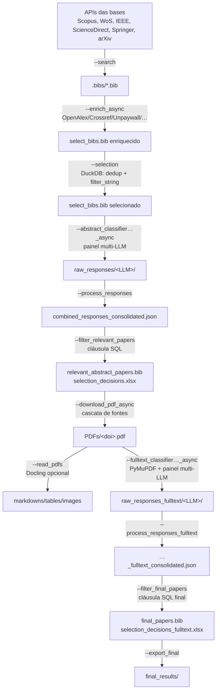

# Arquitetura

Aneta é um **pipeline de linha de comando**: `aneta.py` é uma fina camada de despacho que,
para cada flag, chama uma função de orquestração de um módulo em `src/`. Não há servidor,
fila ou estado em memória entre execuções — **o estado vive no sistema de arquivos**
(sob `.data/`), o que torna cada etapa retomável de forma independente.

```
CLI (aneta.py)
  └─ setup_environment()  → carrega .conf + config/.env, exporta PROJECT_PATH
  └─ despacho por flag     → função run_*  → módulo src/*
  └─ record_stage_auto()   → grava métricas da etapa (PipelineReport)
```

O bloco principal de `aneta.py` faz o despacho por flag e, ao final, registra a métrica da
etapa via o mapa `_STAGE_BY_ARG`.

---

## Componentes e responsabilidades

| Camada | Módulo(s) | Responsabilidade |
|---|---|---|
| **CLI / despacho** | `aneta.py` | Carrega config, despacha a flag, registra métrica |
| **Busca** | `src/Search.py` + `src/SeachDataBases/*` | Consulta as APIs das bases; traduz a DSL |
| **Tradução de query** | `src/SeachDataBases/query_language.py` | DSL booleana → sintaxe nativa de cada API |
| **Enriquecimento** | `src/EnrichBibtex.py`, `src/EnrichBibtexAsync.py` | Preenche DOI/abstract/keywords/JCR/SCImago por API |
| **Seleção (metadados)** | `src/Selection.py` | Dedup + filtro de escopo (DuckDB) |
| **Triagem (abstract)** | `src/GenerativeAI/LLMSelectPapersByAbstractOneOnOneAsync.py` | Classificação multi-LLM por abstract |
| **Triagem (texto completo)** | `src/GenerativeAI/LLMSelectPapersByFullTextAsync.py` | Classificação multi-LLM por texto completo |
| **Config de LLM** | `src/GenerativeAI/multi_llm_config.py` | `LLM_CLIENTS_*` → lista de clientes |
| **Consolidação** | `src/GenerativeAI/LLMUtilExcel.py` | Mescla respostas e conta votos por critério |
| **Prompts / schema** | `src/GenerativeAI/LLMUtils.py` | BibTeX → JSON + montagem dos prompts |
| **Texto p/ full-text** | `src/GenerativeAI/PDFTextExtract.py` | Texto do PDF (markdown Docling ou PyMuPDF) |
| **Decisão (filtro SQL)** | `src/FilterRelevantPapers.py` | Aplica a cláusula de inclusão; gera a planilha de decisão |
| **Download** | `src/DonwloadPapers.py` | Cascata de download dos PDFs (+ assistido) |
| **Leitura de PDF** | `src/PDFReader.py` | Docling: markdown/tabelas/imagens |
| **Relatório** | `src/PipelineReport.py` | Funil PRISMA-like (md/csv/json) |
| **Entrega** | `src/ExportFinalResults.py` | Pasta de entrega final |
| **Infra compartilhada** | `src/Config.py`, `src/BibTex.py`, `src/Database.py` | Config/paths, I/O de BibTeX, cache LanceDB |

> O Aneta também tem uma análise bibliométrica lateral (via R), fora do funil de inclusão
> e **fora do escopo desta documentação**.

---

## Fluxo de dados (ponta a ponta)



Pontos-chave do fluxo:

- O BibTeX é o **formato de troca** entre etapas; cada etapa lê o artefato da anterior e
  escreve o seu. Os caminhos são parametrizados no `.conf`.
- A triagem por texto completo **não depende** de `--read_pdfs`: `PDFTextExtract.extract_text`
  usa o markdown do Docling se existir, senão extrai com PyMuPDF direto do PDF.

---

## Fronteiras e integrações externas

| Integração | Onde | Credencial (em `config/.env`) |
|---|---|---|
| Scopus / ScienceDirect (Elsevier) | busca, enriquecimento, download | `ELSEVIER_API_KEY`, `ELSEVIER_INSTTOKEN` |
| Web of Science (Clarivate) | busca | `WEB_OF_SCIENCE_KEY` |
| IEEE Xplore | busca | `IEEE_API_KEY` |
| Springer Nature | busca | `SPRINGER_API_KEY` |
| arXiv | busca | (sem chave) |
| OpenAlex / Crossref / Unpaywall / DataCite / Semantic Scholar | enriquecimento, download | (sem chave) |
| LLMs: OpenAI / Gemini (Google) / DeepSeek | triagem | painéis `LLM_CLIENTS_*` |
| Docling | leitura de PDF | (dep. Python pesada) |
| Playwright/Chromium, PyPaperBot | download | (deps sob demanda) |

Caches e estado:

- **LanceDB** (`.data/.db`) — cache de respostas de API no enriquecimento assíncrono
  (`src/Database.py`), para não repetir chamadas.
- **Sistema de arquivos** — toda saída sob `.data/` (gitignored); ver
  [saidas-funil.md](saidas-funil.md).

---

## Decisões e restrições de projeto

- **Etapas idempotentes e retomáveis.** Busca, triagem e download pulam o que já foi feito
  (ciente de DOI). Isso permite parar/retomar e preencher lacunas de provedores que
  falharam — central para runs longos.
- **Decisão de inclusão fora do código.** A regra é uma cláusula SQL em YAML sobre os votos
  consolidados; mudar o critério não exige tocar em Python, e a motivação por artigo é
  derivada da própria cláusula. Ver [triagem-llm.md](triagem-llm.md).
- **Humano no circuito.** A metodologia é autorada em `config/*.yaml`; o facilitador
  confirma cada passo. Ver [facilitador.md](facilitador.md).
- **Precisão de busca por API.** Cada base tem limitações próprias (campos, curingas,
  paginação); a tradução da DSL e o filtro local em DuckDB recuperam a precisão. Ver
  [busca-dsl.md](busca-dsl.md) e `src/SeachDataBases/API_QUERY_SYNTAX.md`.
